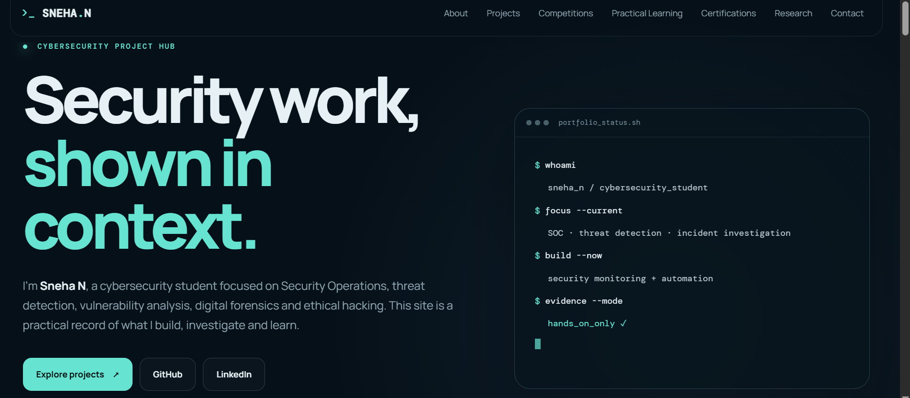

# 🛡️ Sneha N | Cybersecurity Project Hub

A static portfolio website showcasing my hands-on work in **Security Operations, threat detection, vulnerability analysis, digital forensics and ethical hacking**.

🔗 **Live site:** [snehan99.github.io/PORTFOLIO](https://snehan99.github.io/PORTFOLIO/)

  

## 🌐 Portfolio Preview


---

## 👩‍💻 About

I'm Sneha N, a final-year B.Tech Computer Science and Engineering student specializing in Cybersecurity. I'm interested in cybersecurity, ethical hacking, threat detection and security operations.

This portfolio is a practical record of what I build, investigate and learn, with hands-on projects, certifications and research documented separately.

## ✨ What's on the site

| Section | What you'll find |
|---|---|
| **About** | Academic background and cybersecurity interests |
| **Technical Skills** | Programming languages, cybersecurity tools and technologies |
| **Projects** | Featured project **DecoyShield**, with project details and evidence |
| **Practical Learning** | Hands-on cybersecurity labs and TryHackMe practice |
| **Certifications** | Google Cybersecurity Professional Certificate and TryHackMe Pre Security |
| **Research** | Published research paper on deception-based threat detection |
| **Contact** | Email, GitHub, LinkedIn and TryHackMe profile |

## 🚀 Featured Project: DecoyShield

A deception-based honeypot desktop application designed to attract suspicious connections, monitor attacker activity and analyze behavior in a controlled environment.

- Multiple decoy ports and simulated services
- Network connection monitoring
- Attacker IP and activity logging using SQLite
- Threat-level analysis and classification
- Real-time dashboard and attack visualization
- Security alerts and attack reporting interface

**Tech stack:** Python · PyQt · SQLite · Socket Programming · Nmap · Kali Linux

📂 [Source Code](https://github.com/SnehaN99/DecoyShield) · 🖼️ [Project Screenshots](https://github.com/SnehaN99/DecoyShield/tree/main/screenshots)

## 📚 Research

**DecoyShield: A Deception-Based Framework for Proactive Threat Detection and Cyber Defense**

Published in the *International Journal for Research in Applied Science & Engineering Technology (IJRASET)*, Volume 14, Issue IV, April 2026.

📄 [Read Research Paper](https://snehan99.github.io/PORTFOLIO/assets/decoyshield-research-paper.pdf) · 🏅 [View Publication Certificate](https://snehan99.github.io/PORTFOLIO/assets/decoyshield-publication-certificate.jpeg)

## 🎓 Certifications & Learning

- **Google Cybersecurity Professional Certificate:** [View Certificate](https://snehan99.github.io/PORTFOLIO/assets/google-cybersecurity-certificate.pdf) · [Practical Course Portfolio](https://github.com/SnehaN99/Cybersecurity-Portfolio)
- **TryHackMe – Pre Security:** [View Certificate](https://snehan99.github.io/PORTFOLIO/assets/tryhackme-pre-security-certificate.pdf)
- **TryHackMe Profile:** [View Profile](https://tryhackme.com/p/SnehaN)
- **Google Cybersecurity:** Security audits, incident analysis, Linux permissions, SQL queries and Python automation.

## 🧱 Tech & Structure

Built as a static website using HTML, CSS and JavaScript, and deployed through **GitHub Pages**.

```text
PORTFOLIO/
├── index.html
├── style.css
├── script.js
├── assets/
│   ├── certificates
│   ├── research paper
│   └── images
└── README.md
```

## 🛠️ Run locally

Clone the repository:

```bash
git clone https://github.com/SnehaN99/PORTFOLIO.git
cd PORTFOLIO
```

Open `index.html` in your browser, or run a local server:

```bash
python3 -m http.server 8000
```

Then visit `http://localhost:8000`.

## 📬 Contact

- 📧 Email: nambiarsneha316@gmail.com
- 💼 [LinkedIn](https://www.linkedin.com/in/snehan06)
- 🐙 [GitHub](https://github.com/SnehaN99)
- 🧪 [TryHackMe](https://tryhackme.com/p/SnehaN)

---

© Sneha N. All rights reserved.

*This portfolio is continuously updated as I learn, build, investigate and explore cybersecurity.*
